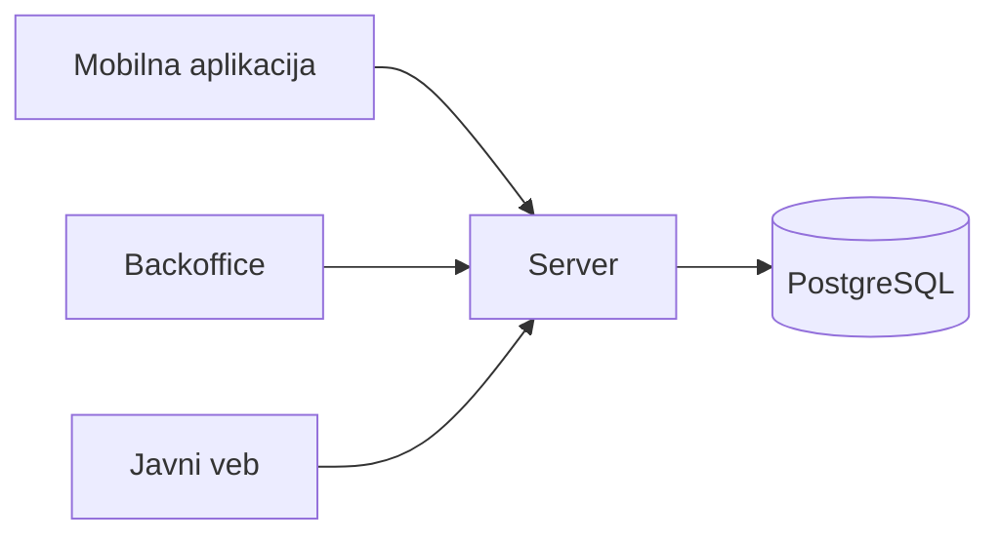

# Ulaznice za studentske događaje

Sistem za prodaju i kontrolu ulaznica za studentske događaje. Organizatori objavljuju događaje sa ograničenim kapacitetom, posetioci preko mobilne aplikacije kupuju karte sa QR kodom, a redari ih na ulazu skeniraju, i kada nema signala. Stranice događaja javno su dostupne na vebu.

Projekat iz predmeta Razvoj multiplatformskih aplikacija, tim 20.

## Tim

| Ime i prezime | Broj indeksa | GitHub nalog |
| --- | --- | --- |
| Filip Čobanin | SI 86/24 | [@1tsn0tf1l1p](https://github.com/1tsn0tf1l1p) |
| Dimitrije Šovljanski | SI 90/24 | [@sovljanskii](https://github.com/sovljanskii) |

## Zahtevi za temu

Glavni pojam sistema je **karta** (ulaznica) za jedan događaj.

1. **Uloge.** Sistem koriste posetioci i osoblje događaja: organizatori i redari. Posetilac kupuje i otkazuje samo svoje karte, organizator objavljuje događaje i vidi sve karte za njih, a redar na ulazu skenira i potvrđuje karte.
2. **Stanja.** Karta prolazi kroz više stanja: rezervisana je dok čeka plaćanje, zatim plaćena, pa iskorišćena kada je redar skenira na ulazu; može biti i otkazana od strane posetioca ili istekla ako nije plaćena na vreme.
3. **Pravila.** Posetilac može da kupi najviše 4 karte za jedan događaj i da ih otkaže najkasnije 24 sata pre početka. Broj prodatih karata ne sme da pređe kapacitet događaja i ista karta ne može dvaput da uđe; to zavisi od karata drugih posetilaca i skeniranja drugih redara, pa konačno odlučuje server.
4. **Rad bez mreže.** Redar pre događaja preuzme spisak važećih karata, pa na ulazu skenira QR kodove i označava karte kao iskorišćene i bez signala; skeniranja se šalju serveru kada se veza vrati. Posetilac svoje karte sa QR kodom vidi i bez mreže.
5. **Posao za osoblje.** Organizator na jednom ekranu vidi sve karte za događaj, prodaju po stanjima, popunjenost i ko je ušao, i ručno potvrđuje ili poništava karte, što je posao za veći ekran.
6. **Javni sadržaj.** Stranica događaja sa nazivom, datumom, mestom, cenom i brojem preostalih mesta zanima i one koji još nemaju nalog, pa ima smisla da je pronađu pretraživači.

## Delovi sistema

| Deo | Korisnici | Tehnologija | Platforme |
| --- | --- | --- | --- |
| Mobilna aplikacija | posetioci, redari | Flutter | Android, iOS |
| Backoffice | organizatori | Flutter | macOS, veb |
| Javni veb | svi posetioci | Jaspr | pregledač |
| Server | ostali delovi sistema | Relic, PostgreSQL | Linux |
| Domenski paket | svi delovi sistema | Dart | sve |

Svi delovi koriste isti domenski paket, u kome su model i pravila. Server čuva podatke i ponovo proverava svako pravilo.

## Stanje projekta

Opis sistema. Detaljan opis domena i kod dodaju se tokom semestra.
