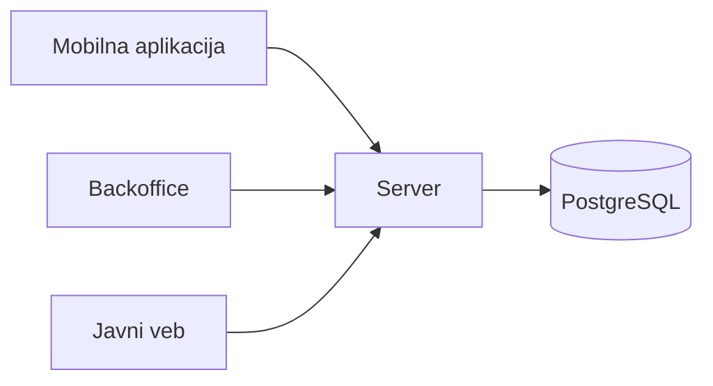

# Ulaznice za studentske događaje

Sistem za prodaju i kontrolu ulaznica za studentske događaje. Organizatori objavljuju događaje sa ograničenim kapacitetom, posetioci preko mobilne aplikacije kupuju karte sa QR kodom, a redari ih na ulazu skeniraju, i kada nema signala. Stranice događaja javno su dostupne na vebu.

Projekat iz predmeta Razvoj multiplatformskih aplikacija, tim 20.

## Tim

| Ime i prezime | Broj indeksa | GitHub nalog |
| --- | --- | --- |
| Filip Čobanin | SI 86/24 | [@1tsn0tf1l1p](https://github.com/1tsn0tf1l1p) |
| Dimitrije Šovljanski | SI 90/24 | [@sovljanskii](https://github.com/sovljanskii) |

## Zahtevi za temu

Glavni pojam sistema je **karta** (ulaznica) za jedan događaj.

1. **Uloge.** Sistem koriste posetioci i osoblje događaja: organizatori i redari. Posetilac kupuje i otkazuje samo svoje karte, organizator objavljuje događaje i vidi sve karte za njih, a redar na ulazu skenira i potvrđuje karte.
2. **Stanja.** Karta prolazi kroz više stanja: rezervisana je dok čeka plaćanje, zatim plaćena, pa iskorišćena kada je redar skenira na ulazu; može biti i otkazana od strane posetioca ili istekla ako nije plaćena na vreme.
3. **Pravila.** Posetilac može da kupi najviše 4 karte za jedan događaj i da ih otkaže najkasnije 24 sata pre početka. Broj prodatih karata ne sme da pređe kapacitet događaja i ista karta ne može dvaput da uđe; to zavisi od karata drugih posetilaca i skeniranja drugih redara, pa konačno odlučuje server.
4. **Rad bez mreže.** Redar pre događaja preuzme spisak važećih karata, pa na ulazu skenira QR kodove i označava karte kao iskorišćene i bez signala; skeniranja se šalju serveru kada se veza vrati. Posetilac svoje karte sa QR kodom vidi i bez mreže.
5. **Posao za osoblje.** Organizator na jednom ekranu vidi sve karte za događaj, prodaju po stanjima, popunjenost i ko je ušao, i ručno potvrđuje ili poništava karte, što je posao za veći ekran.
6. **Javni sadržaj.** Stranica događaja sa nazivom, datumom, mestom, cenom i brojem preostalih mesta zanima i one koji još nemaju nalog, pa ima smisla da je pronađu pretraživači.

## Delovi sistema

| Deo | Korisnici | Tehnologija | Platforme |
| --- | --- | --- | --- |
| Mobilna aplikacija | posetioci, redari | Flutter | Android, iOS |
| Backoffice | organizatori, redari | Flutter | macOS, veb |
| Javni veb | svi posetioci | Jaspr | pregledač |
| Server | ostali delovi sistema | Relic, PostgreSQL | Linux |
| Domenski paket | svi delovi sistema | Dart | sve |

Svi delovi koriste isti domenski paket, u kome su model i pravila. Server čuva podatke i ponovo proverava svako pravilo.



## Pokretanje

Potrebni su Docker (Docker Desktop na macOS-u) i Flutter 3.47.9 (Dart 3.13), ista verzija kao u CI-ju. Sa Flutter-om 3.50 `flutter pub get` ne prolazi, jer njegov `flutter_test` traži noviji `test_api` od onog uz koji ide `test` 1.31.1.

### Baza i server

Iz korena čistog klona, bez izmena u `.env`:

```sh
cp .env.example .env
docker compose up -d --build
```

`compose.yaml` podiže tri servisa:

| Servis | Šta radi | Adresa |
| --- | --- | --- |
| `db` | PostgreSQL 17 | `127.0.0.1:5436` |
| `migrate` | dbmate primeni migracije iz `apps/server/migrations`, pa izlazi | — |
| `server` | server u Dartu na Relic-u 1.2.0, slika iz `apps/server/Dockerfile` | http://localhost:8080 |

Lozinka baze, `DEMO_PASSWORD`, `JWT_SECRET`, `PAYMENT_API_KEY` i trajanje prijave su u `.env`, koji nije u git-u. Kada je baza prazna, server upisuje početne podatke: pet događaja, 30 karata u svim stanjima i demo naloge. Lozinke su u bazi samo kao Argon2id heš.

Provera: `docker compose ps -a` (servis `migrate` je `Exited (0)`) i `curl localhost:8080/health` (odgovor `ok`).

| Komanda | Šta radi |
| --- | --- |
| `docker compose logs -f server` | ispis servera; `logs migrate` za migracije |
| `docker compose up -d --build server` | nova slika servera posle izmene u `apps/server` ili u paketima |
| `docker compose stop server` / `start server` | server ne radi, pa ponovo radi (poruka „Nema veze sa serverom.“ u aplikacijama) |
| `docker compose down` | gasi sistem, podaci ostaju |
| `docker compose down -v` | gasi sistem i briše bazu; sledeći `up -d` kreće od nule |
| `docker compose exec db psql -U tim20` | SQL nad bazom |

Istek prijave uživo: u `.env` postaviti `SESSION_TTL_MINUTES=1`, pa `docker compose up -d server`. Posle jednog minuta sledeći zahtev vraća aplikaciju na prijavu sa porukom „Prijava je istekla. Prijavite se ponovo.“ Podrazumevano je 480 minuta.

### Aplikacije

Zavisnosti se povlače jednom, iz korena (pub workspace):

```sh
flutter pub get
```

Svaka aplikacija u svom terminalu:

```sh
cd apps/mobile
flutter run              # Android emulator ili iOS simulator
```

```sh
cd apps/backoffice
flutter run -d macos     # ili -d chrome --web-port 8081
```

Aplikacije same nalaze server: iOS simulator, macOS i pregledač na `localhost:8080`, Android emulator na `10.0.2.2:8080`. Telefon na istoj mreži: `flutter run --dart-define=SERVER_URL=http://<IP računara>:8080`. Server sluša običan HTTP, pa ga Android dozvoljava samo u debug i profile verziji (`usesCleartextTraffic` u `android/app/src/debug` i `src/profile`). Pregledač sme da zove server samo sa adrese iz `CORS_ORIGINS` u `.env`, a `.env.example` dozvoljava backoffice na `http://localhost:8081`; zato `--web-port 8081`.

Prijava ostaje i posle ponovnog pokretanja: na telefonu i na macOS-u token je u Keychain-u ili Keystore-u (`flutter_secure_storage`), a u pregledaču u HttpOnly kolačiću `tim20_session`. Lozinka se nigde ne čuva. Odjava briše prijavu.

### Demo nalozi

Lozinka za sve naloge je vrednost `DEMO_PASSWORD` iz `.env` (u `.env.example`: `tim20-demo`).

| Nalog | Uloga | Aplikacija |
| --- | --- | --- |
| `ana`, `marko` | posetilac | mobilna |
| `organizator` | organizator | backoffice |
| `redar` | redar | backoffice |

Backoffice odbija posetioca („Backoffice je za organizatore i redare.“), a mobilna aplikacija osoblje („Aplikacija je za posetioce. Osoblje koristi backoffice.“). Bez prijave se na telefonu vide događaji i slobodna mesta; kupovina i „Moje karte“ traže prijavu.

### Provera kao na CI-ju

```sh
dart format --output=none --set-exit-if-changed . && flutter analyze
(cd packages/domain && dart test) && (cd packages/use_cases && dart test) && (cd packages/blocs && dart test)
(cd packages/api_contract && dart test -p vm,chrome) && (cd packages/api_mapping && dart test -p vm,chrome) && (cd packages/api_client && dart test -p vm,chrome)
(cd packages/ui && flutter test) && (cd apps/backoffice && flutter test) && (cd apps/mobile && flutter test)
(cd apps/server && dart test -x db)
```

Testovi servera nad bazom (istovremene kupovine i ulazi, prava, prijava) traže `docker compose up -d` i rade nad posebnom bazom `tim20_test`: `cd apps/server && dart test -t db`. CI ih ne pokreće.

## Odluke

| Pitanje | Izbor | Odbačeno (i zašto) |
| --- | --- | --- |
| Pravilo koje zavisi od drugih | Ograničen broj: aktivne karte ne prelaze kapacitet, a posetilac ima najviše 4 aktivne karte po događaju; ista karta ne ulazi dvaput. | — |
| Ko konačno čuva pravilo | Baza: rezervacija zaključa red događaja (`SELECT … FOR UPDATE`), pročita njegove karte i pozove isto domensko pravilo; promena stanja ide uslovnim `UPDATE … WHERE status = …`, pa se pri sukobu ponovi nad svežim stanjem. | Samo provera u use case-u (dva poziva prođu proveru pre upisa); `count(*)` bez zaključavanja; brojač zauzetih mesta (rezervacija sama ističe posle 15 min, pa bi brojač morao da se umanjuje posebnim poslom). |
| Šta vidi zakasneli | `409 not-enough-seats` sa brojem preostalih mesta, ili `409 ticket-limit-exceeded` sa granicom; telefon prikaže razlog i ponovo učita formu kupovine. | Delimična rezervacija: korisnik ne bi znao da je dobio manje karata. |
| Šta od zapisa vidi koja uloga | Bez prijave: događaji i slobodna mesta. Posetilac: samo svoje karte. Osoblje: sve karte događaja, sa imenom posetioca. | Isti odgovor svima, a klijent sakrije polja: podaci ipak stignu na uređaj. |
| Novac, vreme i stanja na mreži | Iznos kao ceo broj dinara uz valutu; vreme u UTC-u, ISO 8601 sa `Z` (vreme bez zone server odbija); stanje kao objekat sa vrstom i podacima (`{"kind": "paid", "at": …}`). | `double` za iznos; lokalno vreme bez zone; stanje kao goli string (gube se vreme, ko i razlog). |
| Deo velike liste | Liste su male (karte jednog događaja, karte jednog posetioca, desetak događaja), pa idu bez stranica; kad bi narasle, kursor `?after=<createdAt>,<id>`. | Broj stranice: kad se lista menja, zapis se preskoči ili ponovi. |
| Kako klijent saznaje za tuđu promenu | Ponovno učitavanje pri otvaranju ekrana, povlačenjem na telefonu, sa **R** i dugmetom u backoffice-u, i posle svake akcije ili odbijanja. | Stalna veza (WebSocket, SSE): za blagajnu i ulaz je osvežavanje dovoljno. |
| Fotografije i fajlovi | Tema ih nema; QR se crta na telefonu iz koda karte. | QR kao slika sa servera: veći odgovor, a isti kod se crta lokalno. |
| Šta pregledač ne dozvoljava | Drugo poreklo: CORS na serveru (`CORS_ORIGINS`). Nema `dart:io`: uslovni import u `api_client`. Nema Keychain-a: HttpOnly kolačić. | `Access-Control-Allow-Origin: *`: uz kolačić ga pregledač ne prihvata. |
| Šta je dostupno bez prijave | Lista i detalj događaja sa slobodnim mestima; kupovina i „Moje karte“ traže prijavu tek kad ih korisnik otvori. | Prijava na ulazu u aplikaciju: posetilac ne bi video ni da li ima karata. |
| Ko sme da menja tuđi zapis | Posetilac samo svoju kartu: plati rezervisanu, otkaže najkasnije 24 h pre početka. Organizator potvrđuje plaćanje, poništava i pušta na ulaz; redar samo pušta na ulaz. Potvrda plaćanja i ulaz su samo za backoffice, pa server posetiocu vraća 403, a tuđa karta 404. | Redar sme da poništava: odluka o novcu i otkazu je organizatorova. |
| Gde se prijava čuva u pregledaču | HttpOnly kolačić `tim20_session`, `SameSite=Lax`. | `localStorage`: svaki skript sa stranice može da pročita token. |
| Spoljni servis | Plaćanje iza porta `PaymentGateway`; lažna naplata je samo na serveru i traži `PAYMENT_API_KEY` iz `.env`. | Ključ u aplikaciji ili u `--dart-define`: korisnik može da ga izvuče. |

## Struktura

```
apps/mobile          mobilna aplikacija za posetioce (Android, iOS)
apps/backoffice      backoffice za organizatore i redare (macOS, veb)
apps/server          server na Relic-u nad PostgreSQL-om, migracije i početni podaci
packages/domain      model, stanja karte, pravila i izračunavanja; čist Dart
packages/use_cases   portovi ka podacima, sat i slučajevi korišćenja; čist Dart
packages/blocs       Bloc-ovi ekrana za oba klijenta; čist Dart
packages/ui          tema, zajednički widget-i, ekran za prijavu i sve poruke na srpskom
packages/api_contract  DTO-i, putanje i kodovi grešaka na mreži; ne zna za domen
packages/api_mapping   prevod domen ↔ ugovor i greške, na jednom mestu, za klijente i server
packages/api_client    portovi preko HTTP-a, na VM-u i u pregledaču
```

Zavisnosti idu samo naniže: `apps → blocs → use_cases → domain`, `apps → ui → domain` i `apps → api_client → api_mapping → api_contract`. Server koristi iste `use_cases` i `domain` nad PostgreSQL adapterom i isti `api_mapping`. Paketi `domain`, `use_cases`, `blocs`, `api_contract`, `api_mapping` i `api_client` ne uvoze Flutter ni platformske biblioteke.

## Stanje projekta

**KT1 — dva klijenta nad istim domenom.** Mobilna aplikacija za posetioca i backoffice za organizatora rade nad istim paketima, sa lažnim podacima u memoriji. Karta prolazi kroz stanja rezervisana → plaćena → iskorišćena, uz otkazanu i isteklu; pravila (najviše 4 karte, otkazivanje do 24 h pre početka, kapacitet, jedan ulaz po karti) su u `packages/domain` i vraćaju tipizovane greške koje aplikacije prevode u poruke.

**KT2 — server i korisnici.** Server na Relic-u nad PostgreSQL-om (Docker Compose, šema iz migracija, početni podaci) je izvor istine za oba klijenta. Pre svakog upisa izvršava iste use case-ove i ista pravila iz `packages/domain`, a pravila koja zavise od drugih korisnika (kapacitet, 4 karte po posetiocu, jedan ulaz po karti) čuva baza zaključavanjem. Prijava sa ulogama (posetilac na telefonu, organizator i redar u backoffice-u) traje koliko server odredi i ostaje posle ponovnog pokretanja. Prava su na jednom mestu (`AccessPolicy`) i proverava ih i server. Rad bez mreže i skeniranje QR koda dolaze u KT3.
